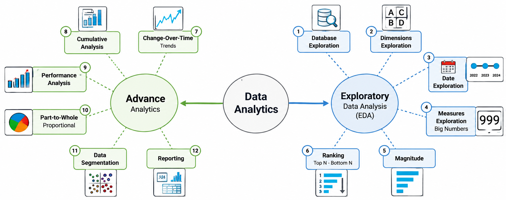

# 📊 SQL Data Analytics Project

## Project Overview

This project performs **Exploratory Data Analysis (EDA), Advanced Analytics, and Business Reporting** using SQL and DuckDB.

The analysis uses customer, product, and sales data from the **Gold Layer** of a data warehouse built with Medallion Architecture and a Star Schema.

### Objectives
- Explore and understand business data.
- Identify sales trends and performance patterns.
- Analyze customer and product behavior.
- Calculate business KPIs.
- Build reusable reporting views for business intelligence.

## Data Sources

| Gold Layer View | Description |
|---|---|
| `gold.dim_customers` | Customer information and demographics |
| `gold.dim_products` | Product details, categories, and costs |
| `gold.fact_sales` | Sales transactions, quantities, prices, and revenue |

# 🔍 1. Exploratory Data Analysis (EDA)

EDA focuses on understanding the dataset, exploring its characteristics, and calculating fundamental business metrics.

| Analysis | Description |
|---|---|
| **Database Exploration** | Examine tables, views, columns, and database metadata. |
| **Dimension Exploration** | Identify unique countries, product categories, and subcategories. |
| **Date Exploration** | Determine sales history, date boundaries, and customer age ranges. |
| **Measures Exploration** | Calculate total sales, orders, quantities, customers, products, and average prices. |
| **Magnitude Analysis** | Compare revenue, customers, and products across different dimensions. |
| **Ranking Analysis** | Identify top- and bottom-performing products and customers. |

### 1.1 Database Exploration

**Purpose:** Understand the database structure and available data.

**Explanation:** Examine database objects, tables, columns, and data types to identify what information is available for analysis.

**Examples:**
- List all tables and views in the database.
- Identify columns in the customer dimension.

**SQL Techniques:** `INFORMATION_SCHEMA.TABLES`, `INFORMATION_SCHEMA.COLUMNS` 

### 1.2 Dimension Exploration

**Purpose:** Identify unique categories and values within the dataset.

**Explanation:** Explore categorical attributes to understand how business data can be grouped and analyzed.

**Examples:**
- List unique customer countries.
- Identify product categories and subcategories.

**SQL Techniques:** `DISTINCT`, `ORDER BY`

### 1.3 Date Exploration

**Purpose:** Understand the historical coverage of the dataset.

**Explanation:** Identify the earliest and latest dates to determine the available time span and customer age ranges.

**Examples:**
- First and last sales order dates.
- Youngest and oldest customer ages.

**SQL Techniques:** `MIN()`, `MAX()`, `DATE_DIFF()`, `CURRENT_DATE`

### 1.4 Measures Exploration

**Purpose:** Calculate essential business metrics.

**Explanation:** Aggregate numerical data to understand overall business performance.

**Examples:**
- Total sales revenue.
- Total orders and items sold.
- Average selling price.
- Total customers and products.

**SQL Techniques:** `SUM()`, `COUNT()`, `COUNT(DISTINCT)`, `AVG()`, `UNION ALL`

### 1.5 Magnitude Analysis

**Purpose:** Compare business metrics across different dimensions.

**Explanation:** Measure the size or contribution of different categories, regions, and customer groups.

**Examples:**
- Total sales by product category.
- Total customers by country.
- Average product cost by category.
- Total revenue by customer.

**SQL Techniques:** `GROUP BY`, `SUM()`, `COUNT()`, `AVG()`, `JOIN`, `ORDER BY`

### 1.6 Ranking Analysis

**Purpose:** Identify top- and bottom-performing business entities.

**Explanation:** Rank products or customers according to revenue, orders, or other performance metrics.

**Examples:**
- Top 5 products by revenue.
- Bottom 5 products by revenue.
- Top 3 customers by number of orders.

**SQL Techniques:** `ORDER BY`, `LIMIT`, `ROW_NUMBER()`, `RANK()`, `GROUP BY`

# 📈 2. Advanced Data Analytics

Advanced Analytics focuses on identifying trends, evaluating performance, and discovering deeper business insights.

| Analysis | Description |
|---|---|
| **Change-Over-Time Analysis** | Analyze yearly and monthly sales trends and customer activity. |
| **Cumulative Analysis** | Calculate running sales totals and moving averages over time. |
| **Performance Analysis** | Compare yearly product sales against historical averages and previous years. |
| **Part-to-Whole Analysis** | Calculate each product category's percentage contribution to total revenue. |
| **Data Segmentation** | Group products by cost ranges and customers by spending behavior and lifespan. |

### 2.1 Change-Over-Time Analysis

**Purpose:** Identify how business metrics change over time.

**Explanation:** Analyze historical data across different time periods to understand growth, decline, and trends.

**Examples:**
- Total sales by year.
- Total sales by month.
- Number of active customers by month.

**SQL Techniques:** `YEAR()`, `MONTH()`, `DATE_TRUNC()`, `STRFTIME()`, `GROUP BY`

### 2.2 Cumulative Analysis

**Purpose:** Track accumulated business performance over time.

**Explanation:** Calculate running totals and averages to understand long-term business progress.

**Examples:**
- Monthly cumulative sales revenue.
- Running total of sales over time.
- Moving average of monthly sales.

**SQL Techniques:** `SUM() OVER()`, `AVG() OVER()`, `ORDER BY`, Subqueries

### 2.3 Performance Analysis

**Purpose:** Evaluate business performance against historical values.

**Explanation:** Compare current performance with previous periods or historical averages to identify improvements and declines.

**Examples:**
- Product sales compared with the previous year.
- Product sales compared with historical average sales.
- Identify products with increasing or decreasing revenue.

**SQL Techniques:** `LAG()`, `AVG() OVER()`, `PARTITION BY`, `CASE WHEN`, CTEs

### 2.4 Part-to-Whole Analysis

**Purpose:** Understand how individual categories contribute to overall business performance.

**Explanation:** Calculate the percentage contribution of each segment relative to the total.

**Examples:**
- Percentage of total revenue by product category.
- Revenue contribution of each category.

**SQL Techniques:** `SUM()`, `SUM() OVER()`, `ROUND()`, CTEs

### 2.5 Data Segmentation

**Purpose:** Group customers and products based on shared characteristics.

**Explanation:** Classify data into meaningful segments using numerical ranges and business rules.

**Examples:**
- Products grouped by cost ranges.
- Customers classified as VIP, Regular, or New.
- Number of customers in each segment.

**SQL Techniques:** `CASE WHEN`, `GROUP BY`, `SUM()`, `COUNT()`, `DATE_DIFF()`, CTEs

# 📋 3. Business Reporting

Business Reporting consolidates analytical metrics into reusable SQL views for reporting and business intelligence.

### 3.1 Customer Report

**View:** `gold.report_customers`

**Purpose:** Provide a comprehensive overview of customer behavior and purchasing performance.

**Explanation:** Combine customer information with sales transactions to calculate customer-level metrics, purchasing patterns, and segments.

**Examples:**
- Total revenue and orders per customer.
- Customer age groups and spending segments.
- Months since the customer's last order.
- Average order value.
- Average monthly spending.

**SQL Techniques:** `CREATE VIEW`, `CTE`, `JOIN`, `GROUP BY`, `CASE WHEN`, `DATE_DIFF()`, Aggregate Functions

### 3.2 Product Report

**View:** `gold.report_products`

**Purpose:** Evaluate product performance and sales activity.

**Explanation:** Combine product details with sales transactions to calculate product-level KPIs and classify products based on revenue.

**Examples:**
- Total sales and orders per product.
- Total quantity sold and unique customers.
- Average selling price.
- Product performance segments.
- Months since the last sale.
- Average monthly revenue.

**SQL Techniques:** `CREATE VIEW`, `CTE`, `JOIN`, `GROUP BY`, `CASE WHEN`, `ROUND()`, `NULLIF()`, Aggregate Functions

## 🛠️ Technologies Used

| Technology | Purpose |
|---|---|
| DuckDB | Analytical database engine |
| SQL | Data exploration and analysis |
| Window Functions | Running totals, ranking, and performance comparison |
| CTEs | Organizing complex analytical queries |
| SQL Views | Reusable reporting datasets |
| Git & GitHub | Version control and documentation |

## 💡 Business Value

This project demonstrates how SQL can transform warehouse data into actionable business insights by:

- Monitoring sales growth and trends.
- Identifying high- and low-performing products.
- Understanding customer purchasing behavior.
- Measuring revenue contributions across categories.
- Segmenting customers and products.
- Preparing structured datasets for BI dashboards.

## Conclusion

This project demonstrates a complete SQL analytics workflow, progressing from **Exploratory Data Analysis → Advanced Analytics → Business Reporting**.

This highlights my practical skills in SQL aggregation, window functions, CTEs, data segmentation, KPI calculation, and analytical reporting using DuckDB Database.